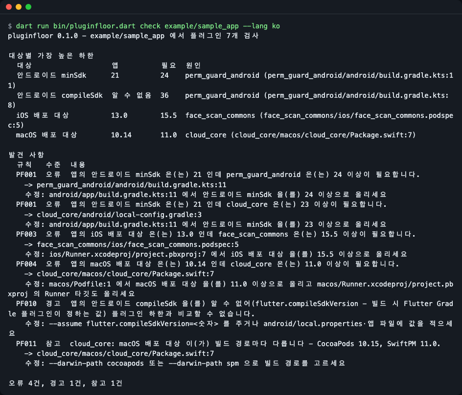
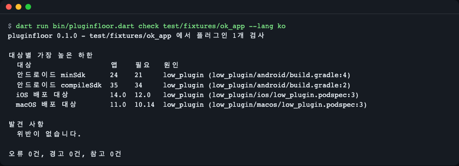
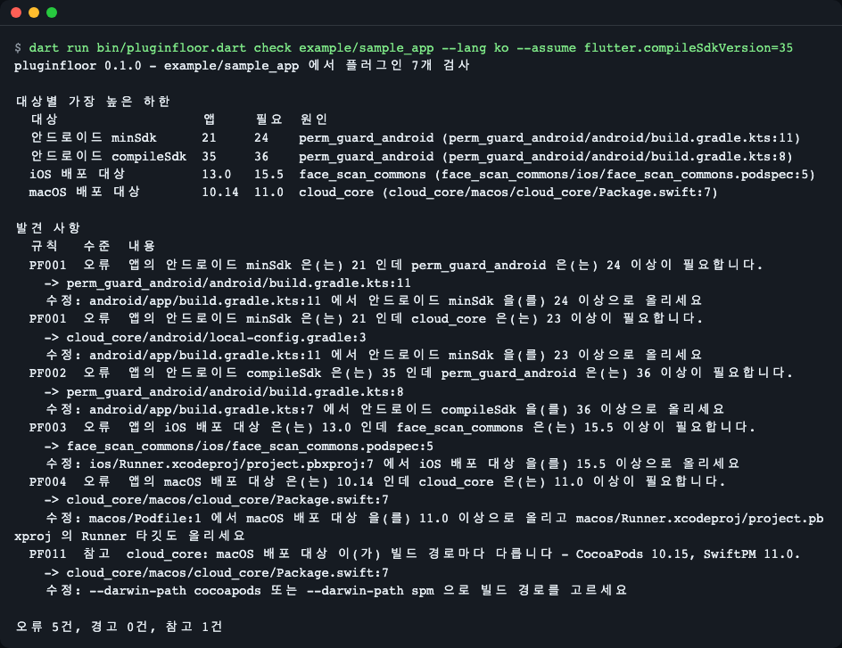
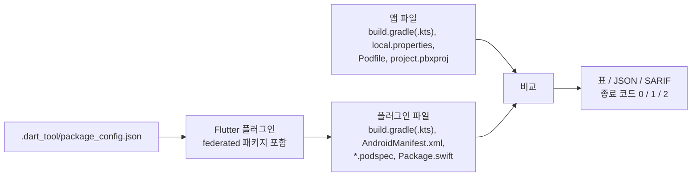

# pluginfloor

[English](README.md) | **한국어**

앱보다 높은 Android minSdk/compileSdk 또는 iOS/macOS 배포 대상을 요구하는 Flutter 플러그인을 한 번에 전부 찾고, 각 하한을 올리는 파일과 줄까지 알려 줍니다. Gradle·CocoaPods·Xcode 가 플러그인 하나씩 빌드를 멈추기 전에 확인하세요. 해석된 플러그인 목록을 정적으로만 읽으므로 빌드 도구·네트워크·키가 필요 없습니다.


*동봉된 예시 앱에서 `pluginfloor check` 실행 결과: 오류 4건, 경고 1건, 참고 1건과 각각의 원인 플러그인 파일·줄.*

## 이런 분께

- 플러그인을 추가·업그레이드했더니 "minSdk 21 은 24 보다 작을 수 없다" 로 빌드가 멈추고, 고치면 다른 플러그인에서 또 멈추는 분.
- 의존성 봇의 풀 리퀘스트마다 전체 빌드 없이 플랫폼 하한이 유지되는지 CI 에서 확인하고 싶은 분.
- 하한 정보를 JSON·SARIF 로 받아 자체 점검이나 코드 스캐닝에 쓰고 싶은 분.

## 설치

[Dart SDK](https://dart.dev/get-dart) 3.8 이상이 필요합니다(Flutter 에 포함). 아직 pub.dev 에 없으므로 clone 해서 실행합니다.

```bash
git clone https://github.com/LeeGyeongPil/pluginfloor
cd pluginfloor
dart pub get
dart run bin/pluginfloor.dart --version
```

```text
pluginfloor 0.1.0
```

검사할 앱에서 `flutter pub get` 을 한 번 실행해 두어야 합니다. 앱의 `.dart_tool/package_config.json` 을 읽기 때문입니다.

## 빠르게 시작하기

동봉된 예시 앱으로 해 봅니다(`example/fake_pub_cache` 의 손으로 만든 가짜 플러그인이라 값은 모두 가상입니다).

```bash
dart run bin/pluginfloor.dart check example/sample_app --lang ko
```

`--lang ko` 를 빼면 로캘에 따라 언어가 정해집니다.

```text
pluginfloor 0.1.0 - example/sample_app 에서 플러그인 7개 검사

대상별 가장 높은 하한
  대상                   앱          필요  원인
  안드로이드 minSdk      21          24    perm_guard_android (perm_guard_android/android/build.gradle.kts:11)
  안드로이드 compileSdk  알 수 없음  36    perm_guard_android (perm_guard_android/android/build.gradle.kts:8)
  iOS 배포 대상          13.0        15.5  face_scan_commons (face_scan_commons/ios/face_scan_commons.podspec:5)
  macOS 배포 대상        10.14       11.0  cloud_core (cloud_core/macos/cloud_core/Package.swift:7)

발견 사항
  규칙   수준  내용
  PF001  오류  앱의 안드로이드 minSdk 은(는) 21 인데 perm_guard_android 은(는) 24 이상이 필요합니다.
    -> perm_guard_android/android/build.gradle.kts:11
    수정: android/app/build.gradle.kts:11 에서 안드로이드 minSdk 을(를) 24 이상으로 올리세요
  PF001  오류  앱의 안드로이드 minSdk 은(는) 21 인데 cloud_core 은(는) 23 이상이 필요합니다.
    -> cloud_core/android/local-config.gradle:3
    수정: android/app/build.gradle.kts:11 에서 안드로이드 minSdk 을(를) 23 이상으로 올리세요
  PF003  오류  앱의 iOS 배포 대상 은(는) 13.0 인데 face_scan_commons 은(는) 15.5 이상이 필요합니다.
    -> face_scan_commons/ios/face_scan_commons.podspec:5
    수정: ios/Runner.xcodeproj/project.pbxproj:7 에서 iOS 배포 대상 을(를) 15.5 이상으로 올리세요
  PF004  오류  앱의 macOS 배포 대상 은(는) 10.14 인데 cloud_core 은(는) 11.0 이상이 필요합니다.
    -> cloud_core/macos/cloud_core/Package.swift:7
    수정: macos/Podfile:1 에서 macOS 배포 대상 을(를) 11.0 이상으로 올리고 macos/Runner.xcodeproj/project.pbxproj 의 Runner 타깃도 올리세요
  PF010  경고  앱의 안드로이드 compileSdk 을(를) 알 수 없어(flutter.compileSdkVersion - 빌드 시 Flutter Gradle 플러그인이 정하는 값) 플러그인 하한과 비교할 수 없습니다.
    수정: --assume flutter.compileSdkVersion=<숫자> 를 주거나 android/local.properties·앱 파일에 값을 적으세요
  PF011  참고  cloud_core: macOS 배포 대상 이(가) 빌드 경로마다 다릅니다 - CocoaPods 10.15, SwiftPM 11.0.
    -> cloud_core/macos/cloud_core/Package.swift:7
    수정: --darwin-path cocoapods 또는 --darwin-path spm 으로 빌드 경로를 고르세요

오류 4건, 경고 1건, 참고 1건
```

읽는 법:

- **대상별 가장 높은 하한** 은 요약입니다. 플랫폼마다 앱 값, 플러그인이 요구하는 가장 높은 값, 그 값을 올린 플러그인(`파일:줄`)을 보여 줍니다.
- **발견 사항** 은 위반한 플러그인마다 한 줄이며, 고칠 앱 파일과 줄을 가리키는 `수정:` 이 붙습니다.
- 오류가 있어 종료 코드는 `1` 입니다. 내 앱에 쓸 때는 `example/sample_app` 대신 앱 폴더를 적습니다(기본값은 현재 폴더).

모든 하한을 만족하면 `위반이 없습니다.` 가 나오고 종료 코드는 `0` 입니다.

```text
pluginfloor 0.1.0 - test/fixtures/ok_app 에서 플러그인 1개 검사

대상별 가장 높은 하한
  대상                   앱    필요   원인
  안드로이드 minSdk      24    21     low_plugin (low_plugin/android/build.gradle:4)
  안드로이드 compileSdk  35    34     low_plugin (low_plugin/android/build.gradle:2)
  iOS 배포 대상          14.0  12.0   low_plugin (low_plugin/ios/low_plugin.podspec:3)
  macOS 배포 대상        11.0  10.14  low_plugin (low_plugin/macos/low_plugin.podspec:3)

발견 사항
  위반이 없습니다.

오류 0건, 경고 0건, 참고 0건
```


*동봉된 통과 예시 `test/fixtures/ok_app`.*

### 중요: Flutter 기본 템플릿 앱

새로 `flutter create` 한 앱은 `android/app/build.gradle.kts` 에 `minSdk = flutter.minSdkVersion`, `compileSdk = flutter.compileSdkVersion` 이라고 적습니다. 이 값은 빌드 때 Flutter Gradle 플러그인이 정하므로 pluginfloor 가 읽을 수 없습니다. **도와주지 않으면 Android 비교를 건너뜁니다**(PF010 경고만 나오고, 플러그인이 더 높은 값을 요구해도 PF001/PF002 는 나오지 않음). 빌드에 쓰는 Flutter 버전의 값을 알려 주거나, 앱 Gradle 파일에 숫자를 직접 적으세요.

```bash
dart run bin/pluginfloor.dart check . --assume flutter.minSdkVersion=21 --assume flutter.compileSdkVersion=35
```

숫자는 설치한 Flutter SDK 의 `FlutterExtension.kt`(`packages/flutter_tools/gradle/src/main/kotlin/`)에 적힌 기본값입니다. Flutter 3.32.4 SDK 에서는(2026-11-16 확인) `minSdkVersion = 21`, `compileSdkVersion = 35` 입니다. Flutter 버전마다 달라지니 내 버전에서 확인하세요. SDK 에서 자동으로 읽는 기능은 아직 없습니다.

## 사용법

```bash
dart run bin/pluginfloor.dart check [app_dir] [options]
```

| 옵션 | 하는 일 | 예 |
|---|---|---|
| `--assume KEY=VALUE` | 정적으로 풀 수 없는 이름에 값을 지정(반복 가능) | `--assume flutter.compileSdkVersion=35` |
| `--darwin-path cocoapods\|spm\|both` | 하한을 정할 Apple 빌드 경로(기본 `both`, 높은 값) | `--darwin-path cocoapods` |
| `--format table\|json\|sarif` | 보고서 형식 | `--format sarif` |
| `--output FILE` | 보고서를 파일로 쓰고 stdout 에는 한 줄 요약만 | `--output floors.sarif` |
| `--all` | 위반뿐 아니라 모든 플러그인 하한도 나열 | `--all` |
| `--strict` | 경고(PF010, PF012)도 실패로 처리 | `--strict` |
| `--package-config PATH` | 다른 `package_config.json` 사용 | |
| `--lang en\|ko` | 출력 언어 | `--lang ko` |
| `--version`, `-h` | 버전, 도움말 | |

종료 코드: `0` 오류 없음, `1` 위반(또는 `--strict` 의 경고), `2` 사용법·입력 오류(예: `package_config.json` 없음).

규칙: PF001 Android minSdk, PF002 Android compileSdk, PF003 iOS·PF004 macOS 배포 대상은 오류, PF010(정적으로 풀 수 없는 값)·PF012(앱 값을 못 찾음)는 경고, PF011(CocoaPods 와 SwiftPM 하한이 다름)은 참고입니다. 자세한 내용과 JSON 구조는 [doc/output-schema.md](doc/output-schema.md).

### 모르는 값 채우기

`flutter.compileSdkVersion` 은 빌드 때 Flutter Gradle 플러그인이 정하므로 추측하지 않고 PF010 으로 알립니다. 실제로 빌드에 쓰는 값을 주세요.

```bash
dart run bin/pluginfloor.dart check example/sample_app --lang ko --assume flutter.compileSdkVersion=35
```


*PF010 이 사라지고, 플러그인이 compileSdk 36 을 요구하므로 PF002 가 나타납니다.*

### Apple 빌드 경로 고르기

`cloud_core` 는 podspec 에 10.15, `Package.swift` 에 11.0 을 적었습니다. 기본은 높은 값입니다. CocoaPods 경로만 보려면 다음과 같이 합니다.

```bash
dart run bin/pluginfloor.dart check example/sample_app --lang ko --darwin-path cocoapods
```

macOS 하한이 `10.15` 가 되고 PF004 는 `cloud_core/macos/cloud_core.podspec:5` 를 가리킵니다.

### CI 용 보고서

```bash
dart run bin/pluginfloor.dart check example/sample_app --lang ko --format sarif --output floors.sarif
```

```text
보고서를 floors.sarif 에 썼습니다(오류 4건, 경고 1건)
```

JSON(`--format json`)과 SARIF 2.1.0 은 결과가 항상 같고 앱 기준 상대 경로만 씁니다(플러그인 파일은 `<package>/<path>`). SARIF 에서는 고칠 앱 파일이 주 위치, 하한을 올리는 플러그인 파일이 관련 위치입니다.

GitHub Actions 작업 예시(뼈대이며 레포에 맞게 고치세요).

```yaml
jobs:
  floors:
    runs-on: ubuntu-latest
    steps:
      - uses: actions/checkout@v4
      - uses: dart-lang/setup-dart@v1
      # 여기에 Flutter 설정과 `flutter pub get` 단계를 넣어
      # .dart_tool/package_config.json 이 생기게 합니다
      - run: |
          git clone --depth 1 https://github.com/LeeGyeongPil/pluginfloor "$RUNNER_TEMP/pluginfloor"
          cd "$RUNNER_TEMP/pluginfloor" && dart pub get
          # 두 --assume 값은 CI 에서 쓰는 Flutter 버전의 기본값으로 바꾸세요
          # ("Flutter 기본 템플릿 앱" 참고). 앱 Gradle 파일에 숫자를 직접 적었다면
          # 필요 없고, 그때 --strict 는 값이 나중에 알 수 없음으로 바뀌는 것도 막아 줍니다.
          dart run bin/pluginfloor.dart check "$GITHUB_WORKSPACE" --strict \
            --assume flutter.minSdkVersion=21 --assume flutter.compileSdkVersion=35
```

`--assume` 없이 Android 플러그인이 하나라도 있는 기본 템플릿 앱에 `--strict` 를 쓰면 PF010 경고 때문에 매번 실패합니다.

## 설정

설정 파일은 없고 옵션과 환경변수 하나뿐입니다.

| 변수 | 뜻 | 기본값 |
|---|---|---|
| `PLUGINFLOOR_LANG` | `en` 또는 `ko` | `LC_ALL`, `LC_MESSAGES`, `LANG` 순으로 확인(`ko` 로 시작하면 한국어, 아니면 영어) |

우선순위는 `--lang`, `PLUGINFLOOR_LANG`, 로캘 변수 순입니다. JSON·SARIF 의 필드 이름과 규칙 ID 는 언어와 무관합니다.

## 동작 원리



1. `package_config.json` 에서 pubspec 에 `flutter: plugin:` 이 있는 패키지를 고릅니다(federated 구현 패키지 포함). 앱 자신과 플러그인의 `example/` 폴더는 제외합니다.
2. 각 플러그인의 Gradle 파일·매니페스트에서 minSdk/compileSdk 를, podspec·`Package.swift` 에서 배포 대상을 줄 번호와 함께 읽습니다.
3. 앱의 파일에서 같은 값을 읽습니다.
4. 대상마다 플러그인별 가장 높은 값을 남기고, 앱 값보다 높은 것을 보고합니다.
5. 정적으로 정할 수 없는 값(`flutter.*`, `rootProject.*`, Ruby 식)은 추측하지 않고 알 수 없음으로 보고합니다. 리터럴 `ext` 값을 가진 `apply from:` 한 단계는 풀어 줍니다.

알려진 한계: Gradle 버전 카탈로그, `rootProject.ext`, 조건식, `-P` 덮어쓰기는 알 수 없음으로 남습니다. 앱 Gradle 파일에서는 첫 `minSdk`/`compileSdk` 선언만 쓰고(productFlavors 미지원), `Runner.xcodeproj` 만 읽으며, tvOS·watchOS·visionOS·Windows·Linux·Web 은 범위 밖입니다.

## 언제 쓰나

- 잘 맞는 경우: 플러그인 업그레이드 뒤 CI 에서 플랫폼 하한 문제를 파일·줄과 함께 한 번에 보고 싶을 때.
- 빌드를 하지 않으므로 빌드 시점에 정해지는 값은 볼 수 없습니다. 최종 확인은 실제 빌드로 하세요.
- 다른 도구(2026-11-16 확인): 앱 자체 설정을 Flutter·스토어 요구와 견주려면 [flutter_health_check](https://pub.dev/packages/flutter_health_check) 입니다. 이 패키지 페이지에는 플러그인별 minSdk·podspec·`Package.swift` 하한을 읽는다는 설명이 없습니다. Flutter 자체 빌드는 문제를 만나는 시점에 알려 주고, pluginfloor 는 빌드 전에 한꺼번에 모아 줍니다.
- "오류가 하나씩 나오는" 경험은 흔합니다. 예: [flutter_file_picker#1522](https://github.com/miguelpruivo/flutter_file_picker/issues/1522), [flutter_background_service#394](https://github.com/ekasetiawans/flutter_background_service/issues/394)(2026-11-16 확인).
- Flutter 내장 compileSdk 불일치 경고는 [통합 테스트](https://flutter.googlesource.com/mirrors/flutter/+/254a796bc3f8a32d3e09c1416bce7b7b9f1ba33b/packages/flutter_tools/test/integration.shard/android_plugin_compilesdkversion_mismatch_test.dart)가 있으며 compileSdk 만 다룹니다.

## 자주 겪는 문제

| 증상 | 원인 | 해결 |
|---|---|---|
| 종료 코드 2, `flutter pub get` 안내 | `.dart_tool/package_config.json` 없음 | 앱에서 `flutter pub get` 실행 또는 `--package-config` 지정 |
| compileSdk·minSdk 에 PF010 경고 | 값이 빌드 시점(`flutter.*`)에 정해짐 | `--assume 이름=값` 을 주거나 `android/local.properties` 에 적기 |
| iOS 에 PF012 경고 | `Podfile`·`project.pbxproj` 에서 배포 대상을 못 찾음 | Podfile 에 `platform :ios, '13.0'` 처럼 적기 |
| 영어를 기대했는데 한국어가 나옴 | 로캘이 한국어 | `--lang en` 또는 `PLUGINFLOOR_LANG=en` |
| Xcode 와 macOS 하한이 다름 | CocoaPods 와 SwiftPM 값이 다름(PF011) | `--darwin-path` 로 경로 선택 |

## 개발·기여

```bash
dart analyze --fatal-infos
dart test
```

버그·제안은 이슈로 남겨 주세요. 변경 기록은 [CHANGELOG.md](CHANGELOG.md).

## 라이선스

MIT.
