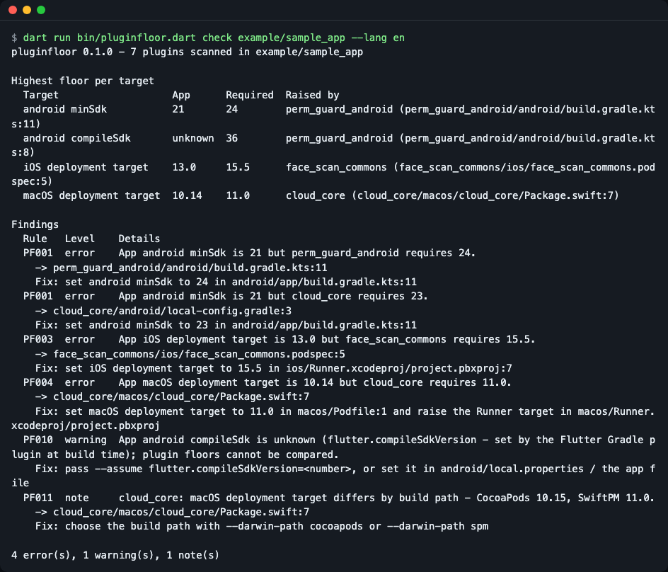
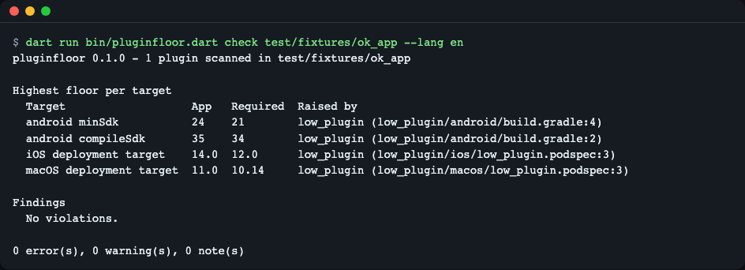
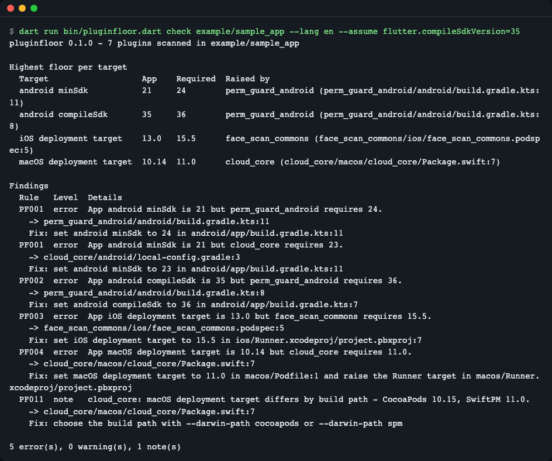
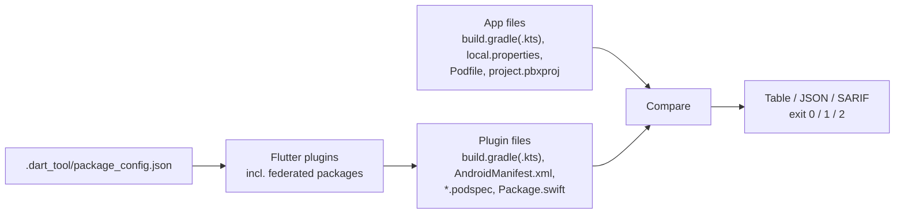

# pluginfloor

**English** | [한국어](README.ko.md)

Find every Flutter plugin that needs a higher Android minSdk/compileSdk or iOS/macOS deployment target than your app has, with the exact file and line that raises each floor, before Gradle, CocoaPods or Xcode fail one plugin at a time. It reads your resolved plugins statically: no build tools, network or keys needed.


*`pluginfloor check` on the bundled sample app: four errors, one warning, one note, and the plugin file and line behind each.*

## Who it is for

- You add or upgrade a Flutter plugin and the build then stops on "minSdk 21 cannot be smaller than 24", fixed, rebuilt, then another plugin stops it.
- A dependency bot opens a pull request and you want CI to say whether the platform floors still hold, without running a full build.
- You want the floors as JSON or SARIF to feed into your own checks or code scanning.

## Install

Requires the [Dart SDK](https://dart.dev/get-dart) 3.8 or newer (it ships with Flutter). Not on pub.dev yet, so run it from a clone:

```bash
git clone https://github.com/LeeGyeongPil/pluginfloor
cd pluginfloor
dart pub get
dart run bin/pluginfloor.dart --version
```

```text
pluginfloor 0.1.0
```

Your app must have had `flutter pub get` run once, because pluginfloor reads `.dart_tool/package_config.json` from it.

## Quick start

Try it on the bundled sample app (hand-made fake plugins in `example/fake_pub_cache`, so all values are made up):

```bash
dart run bin/pluginfloor.dart check example/sample_app --lang en
```

Use `--lang en` to force English; without it the language follows your locale.

```text
pluginfloor 0.1.0 - 7 plugins scanned in example/sample_app

Highest floor per target
  Target                   App      Required  Raised by
  android minSdk           21       24        perm_guard_android (perm_guard_android/android/build.gradle.kts:11)
  android compileSdk       unknown  36        perm_guard_android (perm_guard_android/android/build.gradle.kts:8)
  iOS deployment target    13.0     15.5      face_scan_commons (face_scan_commons/ios/face_scan_commons.podspec:5)
  macOS deployment target  10.14    11.0      cloud_core (cloud_core/macos/cloud_core/Package.swift:7)

Findings
  Rule   Level    Details
  PF001  error    App android minSdk is 21 but perm_guard_android requires 24.
    -> perm_guard_android/android/build.gradle.kts:11
    Fix: set android minSdk to 24 in android/app/build.gradle.kts:11
  PF001  error    App android minSdk is 21 but cloud_core requires 23.
    -> cloud_core/android/local-config.gradle:3
    Fix: set android minSdk to 23 in android/app/build.gradle.kts:11
  PF003  error    App iOS deployment target is 13.0 but face_scan_commons requires 15.5.
    -> face_scan_commons/ios/face_scan_commons.podspec:5
    Fix: set iOS deployment target to 15.5 in ios/Runner.xcodeproj/project.pbxproj:7
  PF004  error    App macOS deployment target is 10.14 but cloud_core requires 11.0.
    -> cloud_core/macos/cloud_core/Package.swift:7
    Fix: set macOS deployment target to 11.0 in macos/Podfile:1 and raise the Runner target in macos/Runner.xcodeproj/project.pbxproj
  PF010  warning  App android compileSdk is unknown (flutter.compileSdkVersion - set by the Flutter Gradle plugin at build time); plugin floors cannot be compared.
    Fix: pass --assume flutter.compileSdkVersion=<number>, or set it in android/local.properties / the app file
  PF011  note     cloud_core: macOS deployment target differs by build path - CocoaPods 10.15, SwiftPM 11.0.
    -> cloud_core/macos/cloud_core/Package.swift:7
    Fix: choose the build path with --darwin-path cocoapods or --darwin-path spm

4 error(s), 1 warning(s), 1 note(s)
```

How to read it:

- **Highest floor per target** is the summary: for each platform, the app value, the highest value any plugin requires, and who raised it (`file:line` inside the plugin).
- **Findings** has one row per violating plugin, each with a `Fix:` line pointing at the app file and line to edit.
- Exit code is `1` here because there are errors. For your own app, replace `example/sample_app` with its folder (default: the current directory).

An app that satisfies every floor prints `No violations.` and exits `0`:

```text
pluginfloor 0.1.0 - 1 plugin scanned in test/fixtures/ok_app

Highest floor per target
  Target                   App   Required  Raised by
  android minSdk           24    21        low_plugin (low_plugin/android/build.gradle:4)
  android compileSdk       35    34        low_plugin (low_plugin/android/build.gradle:2)
  iOS deployment target    14.0  12.0      low_plugin (low_plugin/ios/low_plugin.podspec:3)
  macOS deployment target  11.0  10.14     low_plugin (low_plugin/macos/low_plugin.podspec:3)

Findings
  No violations.

0 error(s), 0 warning(s), 0 note(s)
```


*The bundled passing fixture `test/fixtures/ok_app`.*

### Important: apps on the default Flutter template

A new `flutter create` app writes `minSdk = flutter.minSdkVersion` and `compileSdk = flutter.compileSdkVersion` in `android/app/build.gradle.kts`. Those values are set by the Flutter Gradle plugin at build time, so pluginfloor cannot read them. **Without help, the Android comparison is skipped** (PF010 warnings, and no PF001/PF002 even if a plugin needs more). Tell it the values of the Flutter version you build with, or write literal numbers in the app Gradle file:

```bash
dart run bin/pluginfloor.dart check . --assume flutter.minSdkVersion=21 --assume flutter.compileSdkVersion=35
```

Where to get the numbers: they are the defaults in `FlutterExtension.kt` of your Flutter SDK (`packages/flutter_tools/gradle/src/main/kotlin/`). In the Flutter 3.32.4 SDK (checked 2026-11-16) they are `minSdkVersion = 21` and `compileSdkVersion = 35`; they change between Flutter versions, so check yours. Reading them from the SDK automatically is not implemented yet.

## Usage

```bash
dart run bin/pluginfloor.dart check [app_dir] [options]
```

| Option | What it does | Example |
|---|---|---|
| `--assume KEY=VALUE` | Gives a value to a name that cannot be resolved statically (repeatable) | `--assume flutter.compileSdkVersion=35` |
| `--darwin-path cocoapods\|spm\|both` | Which Apple build path decides the floor (default `both`, the higher) | `--darwin-path cocoapods` |
| `--format table\|json\|sarif` | Report format | `--format sarif` |
| `--output FILE` | Write the report to a file, keep a one-line summary on stdout | `--output floors.sarif` |
| `--all` | Also list every plugin's floor, not only violations | `--all` |
| `--strict` | Treat warnings (PF010, PF012) as failures | `--strict` |
| `--package-config PATH` | Use a different `package_config.json` | |
| `--lang en\|ko` | Output language | `--lang ko` |
| `--version`, `-h` | Version, help | |

Exit codes: `0` no errors, `1` violations (or warnings with `--strict`), `2` usage or input error (for example a missing `package_config.json`).

Rules: PF001 Android minSdk, PF002 Android compileSdk, PF003 iOS and PF004 macOS deployment target are errors; PF010 (value cannot be resolved statically) and PF012 (app value not found) are warnings; PF011 (CocoaPods and SwiftPM floors differ) is a note. Details and the JSON layout: [doc/output-schema.md](doc/output-schema.md).

### Resolve an unknown value

`flutter.compileSdkVersion` is only decided by the Flutter Gradle plugin at build time, so the tool reports PF010 instead of guessing. Give it the value you build with:

```bash
dart run bin/pluginfloor.dart check example/sample_app --lang en --assume flutter.compileSdkVersion=35
```


*PF010 is gone; PF002 appears because a plugin requires compileSdk 36.*

### Pick the Apple build path

`cloud_core` declares 10.15 in its podspec and 11.0 in `Package.swift`. By default the higher one wins; to check only the CocoaPods path:

```bash
dart run bin/pluginfloor.dart check example/sample_app --lang en --darwin-path cocoapods
```

The macOS floor then becomes `10.15` and PF004 points at `cloud_core/macos/cloud_core.podspec:5`.

### Reports for CI

```bash
dart run bin/pluginfloor.dart check example/sample_app --lang en --format sarif --output floors.sarif
```

```text
Report written to floors.sarif (4 error(s), 1 warning(s))
```

JSON (`--format json`) and SARIF 2.1.0 are deterministic and use app-relative paths only (plugin files appear as `<package>/<path>`). In SARIF the app file to edit is the primary location and the plugin file that raises the floor is a related location.

A minimal GitHub Actions job (a sketch; adjust to your repo):

```yaml
jobs:
  floors:
    runs-on: ubuntu-latest
    steps:
      - uses: actions/checkout@v4
      - uses: dart-lang/setup-dart@v1
      # your own steps here: set up Flutter and run `flutter pub get`
      # so that .dart_tool/package_config.json exists
      - run: |
          git clone --depth 1 https://github.com/LeeGyeongPil/pluginfloor "$RUNNER_TEMP/pluginfloor"
          cd "$RUNNER_TEMP/pluginfloor" && dart pub get
          # Replace the two --assume values with the defaults of the Flutter
          # version used in CI (see "apps on the default Flutter template").
          # Not needed if the app Gradle file has literal numbers; then
          # --strict also guards against values becoming unknown later.
          dart run bin/pluginfloor.dart check "$GITHUB_WORKSPACE" --strict \
            --assume flutter.minSdkVersion=21 --assume flutter.compileSdkVersion=35
```

Without the `--assume` flags, an app with the default Android template and at least one Android plugin would fail `--strict` on every run because of the PF010 warnings.

## Configuration

No config file. Options only, plus one environment variable:

| Variable | Meaning | Default |
|---|---|---|
| `PLUGINFLOOR_LANG` | `en` or `ko` | falls back to `LC_ALL`, `LC_MESSAGES`, `LANG` (`ko*` means Korean, anything else English) |

Order of precedence: `--lang`, then `PLUGINFLOOR_LANG`, then the locale variables. The JSON and SARIF field names and rule IDs do not depend on the language.

## How it works



1. It lists packages in `package_config.json` that declare `flutter: plugin:` in their pubspec, federated implementation packages included. The app itself and plugin `example/` folders are ignored.
2. It reads minSdk/compileSdk from each plugin's Gradle files and manifest, and deployment targets from podspecs and `Package.swift`, with line numbers.
3. It reads the same values from your app's files.
4. Per target, it keeps each plugin's highest value and reports the ones above the app value.
5. Values it cannot determine statically (`flutter.*`, `rootProject.*`, Ruby expressions) are reported as unknown, never guessed. One `apply from:` hop with a literal `ext` value is resolved.

Known limits: Gradle version catalogs, `rootProject.ext`, conditional expressions and `-P` overrides stay unknown; only the first `minSdk`/`compileSdk` declaration in the app Gradle file is used (no productFlavors); only `Runner.xcodeproj` is read; tvOS, watchOS, visionOS, Windows, Linux and Web are out of scope.

## When to use it

- Good fit: a quick CI check after plugin upgrades, listing all platform floor problems at once with file and line.
- It does not build anything, so it cannot see values decided at build time; run a real build for the final word.
- Other tools (checked 2026-11-16): [flutter_health_check](https://pub.dev/packages/flutter_health_check) checks the app's own settings against Flutter and store requirements; its page does not describe reading per-plugin minSdk, podspec or `Package.swift` floors. Flutter's own build reports a problem when it hits one; pluginfloor collects them before the build.
- The "one error at a time" experience is common, for example [flutter_file_picker#1522](https://github.com/miguelpruivo/flutter_file_picker/issues/1522) and [flutter_background_service#394](https://github.com/ekasetiawans/flutter_background_service/issues/394) (checked 2026-11-16).
- Flutter's built-in compileSdk mismatch warning is covered by an [integration test](https://flutter.googlesource.com/mirrors/flutter/+/254a796bc3f8a32d3e09c1416bce7b7b9f1ba33b/packages/flutter_tools/test/integration.shard/android_plugin_compilesdkversion_mismatch_test.dart); it concerns compileSdk only.

## Troubleshooting

| Symptom | Cause | Fix |
|---|---|---|
| Exit code 2, hint about `flutter pub get` | No `.dart_tool/package_config.json` | Run `flutter pub get` in the app, or pass `--package-config` |
| PF010 warning for compileSdk or minSdk | The value is set at build time (`flutter.*`) | Pass `--assume NAME=VALUE`, or write it in `android/local.properties` |
| PF012 warning for iOS | No deployment target found in `Podfile` or `project.pbxproj` | Set it in the Podfile (`platform :ios, '13.0'`) |
| Korean text when you expected English | Locale is Korean | Add `--lang en` or set `PLUGINFLOOR_LANG=en` |
| macOS floor differs from what Xcode shows | CocoaPods and SwiftPM disagree (PF011) | Choose a path with `--darwin-path` |

## Development

```bash
dart analyze --fatal-infos
dart test
```

Bugs and ideas are welcome as issues. Changes are listed in [CHANGELOG.md](CHANGELOG.md).

## License

MIT.
